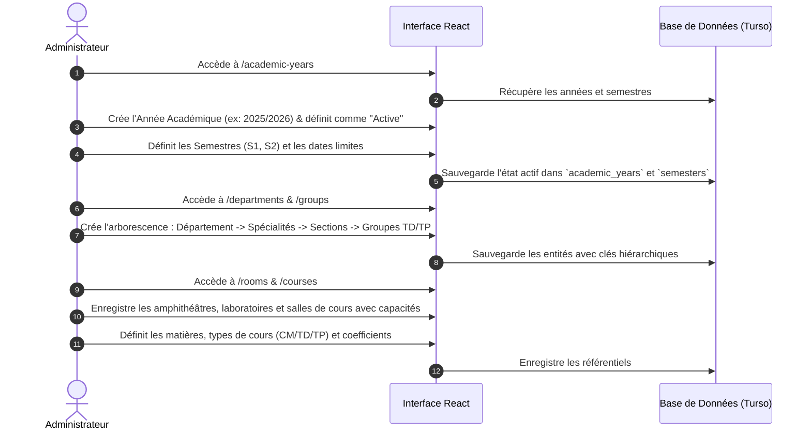
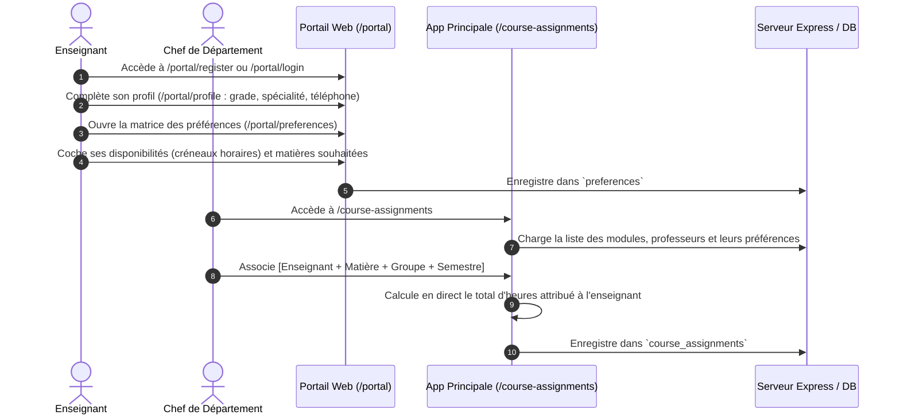
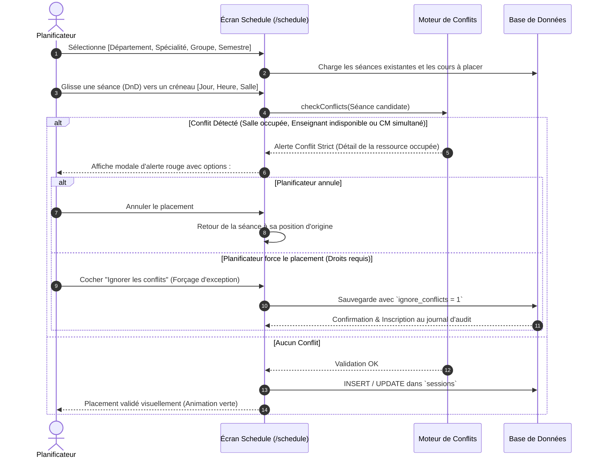
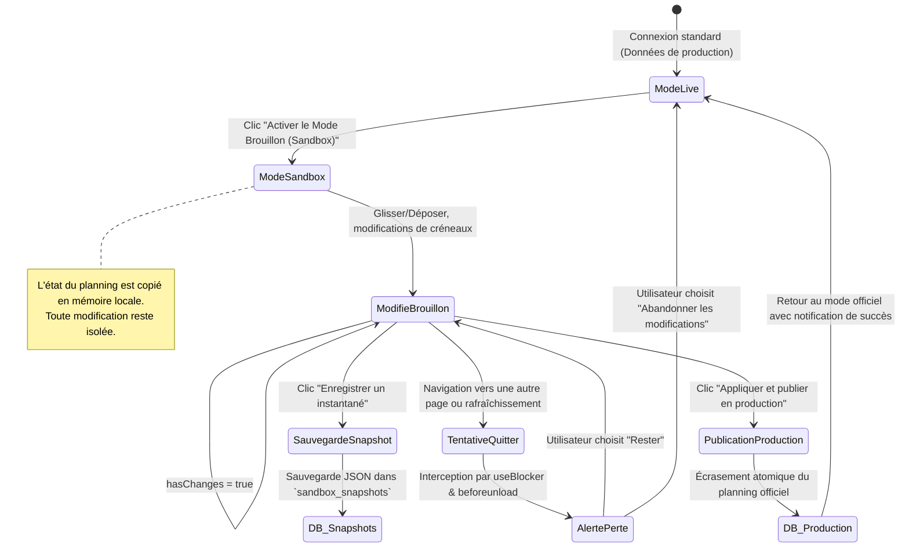
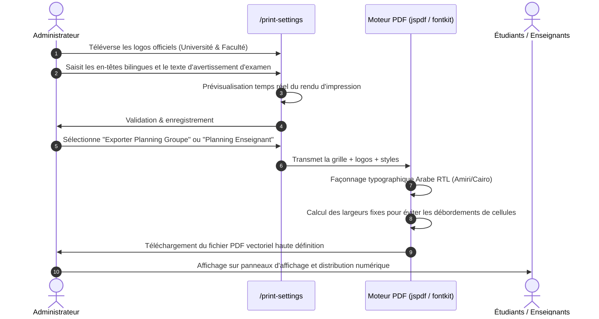
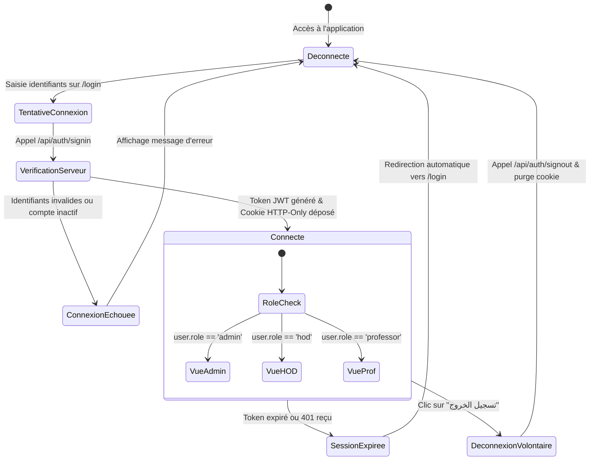

# Document des Flux Applicatifs (APPFLOW) - Djadwal

**Nom du Projet :** Djadwal (نظام إدارة الجداول الأكاديمية)  
**Version :** 28.11.25.Turso  
**Auteur / Concepteur :** Ali Hussain & Équipe Djadwal  
**Statut :** Spécification des Parcours & Flux Utilisateurs  
**Date :** 10 Octobre 2026  
**Dépôt :** `djalle2004-eng/Djadwal`  
**Documents Liés :** [PRD.md](file:///c:/perso/suivie%20online%20130425/suivie29092025/hyper-V/suivie/suivie/PRD.md) | [TRD.md](file:///c:/perso/suivie%20online%20130425/suivie29092025/hyper-V/suivie/suivie/TRD.md)

---

## 1. Vue d'Ensemble & Objectifs

Le document **APPFLOW** cartographie l'ensemble des parcours utilisateurs (User Journeys), la hiérarchie de navigation, l'arbre des routes, les automates d'état (State Machines) et les interactions critiques de la plateforme **Djadwal**.

Il constitue la référence ergonomique et technique pour comprendre comment les utilisateurs naviguent, comment l'état global réagit et comment les flux de données transitent entre les écrans.

---

## 2. Arborescence Globale de Navigation & Routes

```mermaid
graph TD
    Start([Point d'Entrée]) --> RouterCheck{Route demandée ?}

    RouterCheck -->|/portal/*| PortalFlow[Espace Enseignant / Takleef]
    RouterCheck -->|/login| LoginPage[Connexion Principale]
    RouterCheck -->|/database-settings| DBSettings[Configuration Base de Données]
    RouterCheck -->|Route Protégée| AuthCheck{Authentifié ?}

    AuthCheck -->|Non| LoginPage
    AuthCheck -->|Oui| AppLayout[Shell Applicatif : Sidebar + Header + Theme + Sandbox Guard]

    PortalFlow --> PortalLogin[/portal/login]
    PortalFlow --> PortalRegister[/portal/register]
    PortalFlow --> PortalLayout[/portal/layout]
    PortalLayout --> PortalPrefs[/portal/preferences]
    PortalLayout --> PortalProfile[/portal/profile]

    AppLayout --> Dashboard[/ : Tableau de bord]
    AppLayout --> AcadYears[/academic-years : Années & Semestres]
    AppLayout --> Profs[/professors : Gestion Enseignants]
    AppLayout --> Courses[/courses : Gestion Matières]
    AppLayout --> Rooms[/rooms : Gestion Salles]
    AppLayout --> Groups[/groups : Groupes & Spécialités]
    AppLayout --> Assignments[/course-assignments : Affectation des Charges]
    AppLayout --> Schedule[/schedule : Emploi du Temps Interactif]
    AppLayout --> AvailRooms[/available-rooms : Recherche Salles Libres]
    AppLayout --> Workload[/professor-workload : Charges Horaires]
    AppLayout --> GroupSched[/group-schedules : Plannings par Promotion]
    AppLayout --> Swap[/session-swap : Échange de Séances]
    AppLayout --> Move[/session-move : Déplacement de Séances]
    AppLayout --> PrintSet[/print-settings : En-têtes & Logos PDF]
    AppLayout --> UsersAdmin[/users : Utilisateurs & Rôles - Admin]
    AppLayout --> Backup[/backup : Sauvegardes & Restauration - Admin]
    AppLayout --> Audit[/audit-log : Traçabilité & Logs - Admin]
```

---

## 3. Parcours Utilisateurs Principaux (User Journeys)

### 3.1 Parcours 1 : Configuration Initiale & Préparation de la Rentrée
Ce flux est emprunté par le Chef de Scolarité / Administrateur avant toute planification horaire.



---

### 3.2 Parcours 2 : Portail Enseignant, Vœux & Attribution des Charges (Takleef)
Permet aux professeurs de saisir leurs disponibilités et au département de valider leurs charges.



---

### 3.3 Parcours 3 : Planification Interactive de la Grille & Détection de Conflits
Cœur opérationnel de l'application, utilisant la grille interactive avec glisser-déposer.



---

### 3.4 Parcours 4 : Mode Bac à Sable (Sandbox / Mode Brouillon)
Permet d'expérimenter des réorganisations majeures sans perturber le planning en production.



---

### 3.5 Parcours 5 : Permutation (Swap) & Déplacement (Move) Rapide
Outils dédiés pour ajuster rapidement les plannings en cours d'année.

```mermaid
graph TD
    StartMove[Besoin de changer une séance] --> ChoixAction{Type d'action ?}

    ChoixAction -->|Déplacement simple| MoveFlow[/session-move]
    ChoixAction -->|Échange de créneaux| SwapFlow[/session-swap]

    MoveFlow --> SelSessionMove[Sélectionner la séance source]
    SelSessionMove --> SearchSlots[Le système calcule automatiquement les créneaux et salles libres]
    SearchSlots --> PickSlot[Sélectionner le créneau cible proposé]
    PickSlot --> ApplyMove[Validation : La séance est déplacée instantanément]

    SwapFlow --> SelSession1[Sélectionner la Séance A]
    SwapFlow --> SelSession2[Sélectionner la Séance B]
    SelSession2 --> CheckSwap[Le système vérifie la compatibilité croisée des 2 enseignants et 2 groupes]
    CheckSwap -->|Incompatibilité| SwapError[Alerte de conflit croisé]
    CheckSwap -->|Compatible| ExecuteSwap[Permutation atomique des horaires des 2 séances]
```

---

### 3.6 Parcours 6 : Identité Visuelle, Impression & Publication PDF
Gestion des documents officiels de l'établissement.



---

## 4. Automates d'État des Composants Clés (State Machines)

### 4.1 Automate du Glisser-Déposer d'une Séance (`ScheduleDnD`)

| État Actuel | Événement Déclencheur | Condition de Garde | Nouvel État | Action Réalisée |
| :--- | :--- | :--- | :--- | :--- |
| **IDLE** | `dragStart` | Élément déplaçable valide | **DRAGGING** | Élévation visuelle, calcul des zones réceptrices (droppable slots) |
| **DRAGGING** | `dragOver` | Curseur sur une cellule de grille | **HOVERING_SLOT** | Mise en surbrillance de la cellule cible |
| **HOVERING_SLOT**| `dragLeave` | Curseur quitte la cellule | **DRAGGING** | Suppression de la surbrillance |
| **HOVERING_SLOT**| `drop` | Lâcher sur la cellule | **CHECKING_CONFLICTS** | Déclenchement de l'algorithme de contrôle synchrone |
| **CHECKING_CONFLICTS**| `conflictDetected` | Conflit strict et pas de forçage | **CONFLICT_MODAL** | Affichage du modal d'avertissement rouge |
| **CHECKING_CONFLICTS**| `noConflict` | Créneau 100% disponible | **SAVING** | Appel API/IPC d'enregistrement |
| **CONFLICT_MODAL**| `cancel` | L'utilisateur refuse le risque | **IDLE** | Rétablissement de la séance à sa position d'origine |
| **CONFLICT_MODAL**| `override` | Droit `OVERRIDE_CONFLICTS` actif | **SAVING** | Sauvegarde forcée avec `ignore_conflicts = 1` |
| **SAVING** | `saveSuccess` | Réponse serveur 200 OK | **IDLE** | Notification toast verte, mise à jour du state React |
| **SAVING** | `saveError` | Erreur réseau ou DB | **ERROR** | Notification rouge, rollback de l'état local |

---

### 4.2 Automate de Connexion & Session Utilisateur



---

## 5. Gestion des Erreurs et Cas Limites (Edge Cases)

### 5.1 Rupture de Connectivité avec la Base de Données Turso
1. **Détection** : Interception dans `database.js` lors d'un échec de requête HTTP/WSS.
2. **Action 1** : Déclenchement d'une boucle de reconnexion automatique avec backoff exponentiel (1s, 2s, 4s, 8s).
3. **Action 2** : Notification visuelle discrète dans la barre d'en-tête (indicateur réseau jaune/rouge).
4. **Action 3** : Redirection vers `/database-settings` si les variables d'environnement sont absentes ou corrompues.

### 5.2 Tentative de Quitter avec Modifications Non Sauvegardées
1. **Contexte** : Utilisateur modifiant un brouillon en mode Sandbox.
2. **Au changement de route** : Le hook `useBlocker` de `react-router-dom` intercepte la transition et ouvre un dialogue de confirmation ("لديك تغييرات غير محفوظة...").
3. **À la fermeture du navigateur** : L'écouteur `beforeunload` empêche la fermeture accidentelle sans validation.

### 5.3 Conflits Simultanés lors de la Planification Multi-Utilisateurs
1. **Cas** : Deux chefs de département planifient la même salle en même temps.
2. **Résolution** : Le serveur Express réexécute la vérification de conflit atomiquement lors de la transaction d'écriture. Le second utilisateur reçoit une notification immédiate de rejet avec le détail de la séance concurrente prioritaire.
