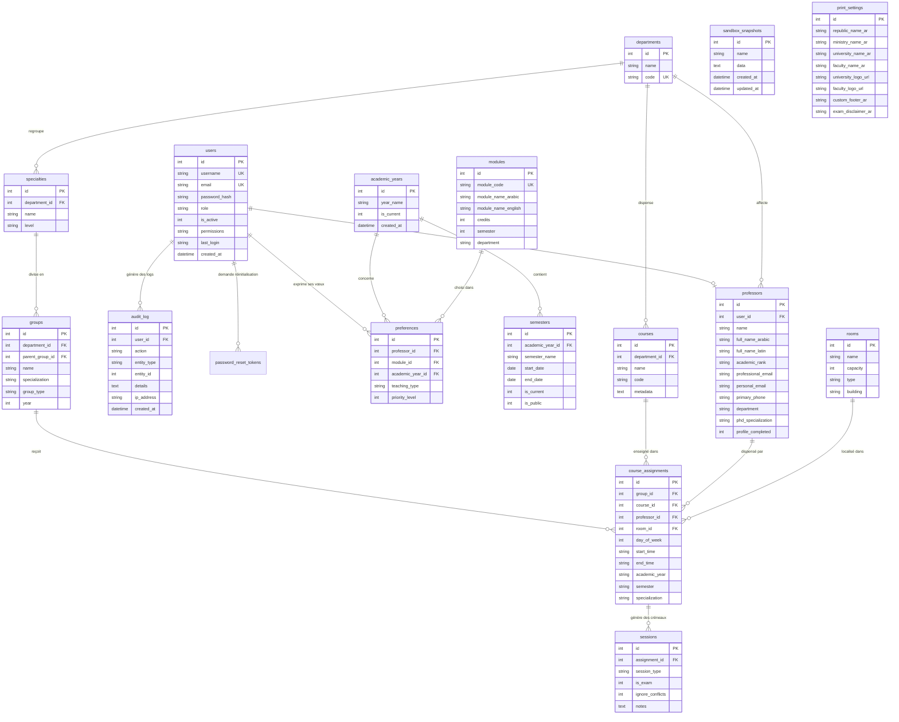

# Schéma Backend & Base de Données (BACKEND SCHEMA) - Djadwal

**Nom du Produit :** Djadwal (نظام إدارة الجداول الأكاديمية)  
**Version Technique :** 28.11.25.Turso  
**Moteur de Base de Données :** Turso (libSQL Serverless / Haute Disponibilité) + Fallback Better-SQLite3  
**Statut :** Schéma Physique & Contrats d'API de Référence  
**Date :** 10 Octobre 2026  
**Dépôt :** `djalle2004-eng/Djadwal`  
**Documents Liés :** [PRD.md](file:///c:/perso/suivie%20online%20130425/suivie29092025/hyper-V/suivie/suivie/PRD.md) | [TRD.md](file:///c:/perso/suivie%20online%20130425/suivie29092025/hyper-V/suivie/suivie/TRD.md) | [APPFLOW.md](file:///c:/perso/suivie%20online%20130425/suivie29092025/hyper-V/suivie/suivie/APPFLOW.md) | [UX_UI_DESIGN.md](file:///c:/perso/suivie%20online%20130425/suivie29092025/hyper-V/suivie/suivie/UX_UI_DESIGN.md)

---

## 1. Vue d'Ensemble & Architecture de Données

Le backend de **Djadwal** s'appuie sur une base de données relationnelle **libSQL / Turso** distribuée mondialement, accessible via le protocole HTTPS/WSS (port 443).

### 1.1 Principes d'Ingénierie des Données
- **Atomicité & Transactions :** Les opérations de planification (assignation, permutation *swap*, et publication *sandbox*) sont encapsulées dans des transactions ACID garantissant zéro état incohérent.
- **Auto-Guérison (Auto-Migration au démarrage) :** Le serveur Express et le Main Process Electron vérifient et créent dynamiquement les colonnes ou tables manquantes (`ensureSandboxTable`, `ensureAuditLogTable`, `ensureSemesterPublicColumn`, `ensurePermissionsColumn`).
- **Immunité aux Injections SQL :** Toutes les requêtes sont systématiquement paramétrées (`$1, $2...` ou `?`) sans aucune concaténation directe de chaîne.

---

## 2. Diagramme Relationnel des Entités (ERD)



---

## 3. Schéma Physique des Tables (DDL Complet)

### 3.1 Tables Système, Utilisateurs & Sécurité

#### Table `users`
```sql
CREATE TABLE IF NOT EXISTS users (
    id INTEGER PRIMARY KEY AUTOINCREMENT,
    username VARCHAR(255) UNIQUE NOT NULL,
    email VARCHAR(255) UNIQUE NOT NULL,
    password_hash TEXT NOT NULL,
    role VARCHAR(50) DEFAULT 'PROFESSOR', -- 'ADMIN', 'HOD', 'PROFESSOR', 'VIEWER'
    is_active BOOLEAN DEFAULT 1,
    permissions TEXT,                     -- JSON sérialisé des droits accordés
    last_login DATETIME,
    created_at DATETIME DEFAULT CURRENT_TIMESTAMP
);
CREATE INDEX IF NOT EXISTS idx_users_email ON users(email);
```

#### Table `password_reset_tokens`
```sql
CREATE TABLE IF NOT EXISTS password_reset_tokens (
    id INTEGER PRIMARY KEY AUTOINCREMENT,
    user_id INTEGER REFERENCES users(id) ON DELETE CASCADE,
    token TEXT UNIQUE NOT NULL,
    expires_at DATETIME NOT NULL,
    created_at DATETIME DEFAULT CURRENT_TIMESTAMP
);
CREATE INDEX IF NOT EXISTS idx_reset_token ON password_reset_tokens(token);
```

#### Table `audit_log`
```sql
CREATE TABLE IF NOT EXISTS audit_log (
    id INTEGER PRIMARY KEY AUTOINCREMENT,
    user_id INTEGER REFERENCES users(id) ON DELETE SET NULL,
    action TEXT NOT NULL,                -- 'CREATE_SESSION', 'OVERRIDE_CONFLICT', 'PUBLISH_SANDBOX', etc.
    entity_type TEXT,                    -- 'SESSION', 'ASSIGNMENT', 'USER', etc.
    entity_id INTEGER,
    details TEXT,                        -- JSON détaillant l'avant/après
    ip_address TEXT,
    created_at DATETIME DEFAULT CURRENT_TIMESTAMP
);
CREATE INDEX IF NOT EXISTS idx_audit_created ON audit_log(created_at DESC);
```

---

### 3.2 Tables Pédagogiques & Dossiers Enseignants

#### Table `professors`
```sql
CREATE TABLE IF NOT EXISTS professors (
    id INTEGER PRIMARY KEY AUTOINCREMENT,
    user_id INTEGER UNIQUE REFERENCES users(id) ON DELETE SET NULL,
    name TEXT NOT NULL,                  -- Nom usuel historique (compatibilité Djadwal)
    full_name_arabic TEXT,               -- الاسم الكامل بالعربية
    full_name_latin TEXT,                -- Nom complet en caractères latins
    academic_rank TEXT,                  -- 'PROFESSEUR', 'MCA', 'MCB', 'MAA', 'MAB', 'VACATAIRE'
    professional_email TEXT,
    personal_email TEXT,
    primary_phone TEXT,
    secondary_phone TEXT,
    department VARCHAR(255),
    phd_specialization TEXT,             -- التخصص الدقيق للدكتوراه
    field_of_research TEXT,              -- مجالات البحث العلمي
    profile_completed BOOLEAN DEFAULT 0,
    created_at DATETIME DEFAULT CURRENT_TIMESTAMP
);
CREATE INDEX IF NOT EXISTS idx_prof_user_id ON professors(user_id);
```

#### Table `departments`
```sql
CREATE TABLE IF NOT EXISTS departments (
    id INTEGER PRIMARY KEY AUTOINCREMENT,
    name TEXT NOT NULL,
    code TEXT UNIQUE
);
```

#### Table `specialties`
```sql
CREATE TABLE IF NOT EXISTS specialties (
    id INTEGER PRIMARY KEY AUTOINCREMENT,
    name TEXT NOT NULL,
    department_id INTEGER REFERENCES departments(id) ON DELETE CASCADE,
    level TEXT                           -- 'L1', 'L2', 'L3', 'M1', 'M2'
);
```

#### Table `groups`
```sql
CREATE TABLE IF NOT EXISTS groups (
    id INTEGER PRIMARY KEY AUTOINCREMENT,
    name TEXT NOT NULL,
    specialization TEXT,
    parent_group_id INTEGER REFERENCES groups(id) ON DELETE SET NULL,
    department_id INTEGER REFERENCES departments(id) ON DELETE CASCADE,
    group_type TEXT CHECK(group_type IN ('SECTION', 'GROUP')),
    year INTEGER
);
CREATE INDEX IF NOT EXISTS idx_groups_dept ON groups(department_id);
```

#### Table `courses`
```sql
CREATE TABLE IF NOT EXISTS courses (
    id INTEGER PRIMARY KEY AUTOINCREMENT,
    name TEXT NOT NULL,
    code TEXT,
    metadata TEXT                        -- Payload JSON : { credits: 3, coef: 2, hours: { course: 1.5, td: 1.5 } }
);
```

#### Table `rooms`
```sql
CREATE TABLE IF NOT EXISTS rooms (
    id INTEGER PRIMARY KEY AUTOINCREMENT,
    name TEXT NOT NULL,
    capacity INTEGER DEFAULT 30,
    type TEXT DEFAULT 'CLASSROOM',       -- 'AMPHI', 'TD', 'LAB_TP', 'EXAM'
    building TEXT
);
```

---

### 3.3 Tables de Planification & Sessions

#### Table `academic_years`
```sql
CREATE TABLE IF NOT EXISTS academic_years (
    id INTEGER PRIMARY KEY AUTOINCREMENT,
    year_name TEXT NOT NULL,             -- ex: '2025/2026'
    is_current INTEGER DEFAULT 0,
    created_at DATETIME DEFAULT CURRENT_TIMESTAMP
);
```

#### Table `semesters`
```sql
CREATE TABLE IF NOT EXISTS semesters (
    id INTEGER PRIMARY KEY AUTOINCREMENT,
    academic_year_id INTEGER REFERENCES academic_years(id) ON DELETE CASCADE,
    semester_name TEXT NOT NULL,         -- 'الفصل الأول', 'الفصل الثاني'
    start_date DATE,
    end_date DATE,
    is_current INTEGER DEFAULT 0,
    is_public INTEGER DEFAULT 1          -- 1 = visible aux étudiants et enseignants
);
CREATE INDEX IF NOT EXISTS idx_semesters_year ON semesters(academic_year_id);
```

#### Table `course_assignments`
```sql
CREATE TABLE IF NOT EXISTS course_assignments (
    id INTEGER PRIMARY KEY AUTOINCREMENT,
    group_id INTEGER REFERENCES groups(id) ON DELETE CASCADE,
    course_id INTEGER REFERENCES courses(id) ON DELETE CASCADE,
    professor_id INTEGER REFERENCES professors(id) ON DELETE CASCADE,
    room_id INTEGER REFERENCES rooms(id) ON DELETE SET NULL,
    day_of_week INTEGER NOT NULL,        -- 0=Samedi, 1=Dimanche, ..., 6=Vendredi
    start_time TEXT NOT NULL,            -- '08:00'
    end_time TEXT NOT NULL,              -- '09:30'
    academic_year TEXT,
    semester TEXT,
    specialization TEXT,
    created_at DATETIME DEFAULT CURRENT_TIMESTAMP
);
CREATE INDEX IF NOT EXISTS idx_assignments_composite 
    ON course_assignments(day_of_week, start_time, room_id, professor_id);
```

#### Table `sessions`
```sql
CREATE TABLE IF NOT EXISTS sessions (
    id INTEGER PRIMARY KEY AUTOINCREMENT,
    assignment_id INTEGER REFERENCES course_assignments(id) ON DELETE CASCADE,
    session_type TEXT DEFAULT 'COURSE',  -- 'COURSE', 'TD', 'TP', 'EXAM'
    is_exam INTEGER DEFAULT 0,           -- 1 = فرض محروس
    ignore_conflicts INTEGER DEFAULT 0,  -- 1 = forçage validé par administrateur
    notes TEXT
);
```

---

### 3.4 Tables Vœux, Brouillons & Configuration Globale

#### Table `modules` (Référentiel Pédagogique Takleef)
```sql
CREATE TABLE IF NOT EXISTS modules (
    id INTEGER PRIMARY KEY AUTOINCREMENT,
    module_code VARCHAR(50) UNIQUE,
    module_name_arabic VARCHAR(255) NOT NULL,
    module_name_english VARCHAR(255) NOT NULL,
    credits INTEGER,
    semester INTEGER,
    department VARCHAR(255) NOT NULL,
    description TEXT,
    created_at DATETIME DEFAULT CURRENT_TIMESTAMP,
    updated_at DATETIME DEFAULT CURRENT_TIMESTAMP
);
```

#### Table `preferences` (Matrice des Vœux)
```sql
CREATE TABLE IF NOT EXISTS preferences (
    id INTEGER PRIMARY KEY AUTOINCREMENT,
    professor_id INTEGER REFERENCES users(id) ON DELETE CASCADE,
    module_id INTEGER REFERENCES modules(id) ON DELETE CASCADE,
    academic_year_id INTEGER REFERENCES academic_years(id) ON DELETE CASCADE,
    teaching_type VARCHAR(20) NOT NULL,  -- 'COURSE', 'TD', 'TP'
    priority_level INTEGER DEFAULT 3,    -- 1 = Prioritaire, 2 = Moyen, 3 = Secondaire
    created_at DATETIME DEFAULT CURRENT_TIMESTAMP,
    updated_at DATETIME DEFAULT CURRENT_TIMESTAMP,
    UNIQUE(professor_id, module_id, academic_year_id)
);
```

#### Table `sandbox_snapshots`
```sql
CREATE TABLE IF NOT EXISTS sandbox_snapshots (
    id INTEGER PRIMARY KEY AUTOINCREMENT,
    name TEXT NOT NULL,
    data TEXT NOT NULL,                  -- Payload JSON sérialisé de l'emploi du temps
    created_at DATETIME DEFAULT CURRENT_TIMESTAMP,
    updated_at DATETIME DEFAULT CURRENT_TIMESTAMP
);
```

#### Table `print_settings`
```sql
CREATE TABLE IF NOT EXISTS print_settings (
    id INTEGER PRIMARY KEY DEFAULT 1,
    republic_name_ar TEXT DEFAULT 'الجمهورية الجزائرية الديمقراطية الشعبية',
    ministry_name_ar TEXT DEFAULT 'وزارة التعليم العالي والبحث العلمي',
    university_name_ar TEXT DEFAULT 'جامعة الشهيد حمه لخضر - الوادي',
    faculty_name_ar TEXT,
    university_logo_url TEXT,
    faculty_logo_url TEXT,
    custom_footer_ar TEXT,
    exam_disclaimer_ar TEXT DEFAULT 'ملاحظة: الغياب عن الفرض المحروس يترتب عليه علامة صفر ولا يعاد إلا بمبرر قانوني',
    updated_at DATETIME DEFAULT CURRENT_TIMESTAMP
);
```

#### Table `app_config`
```sql
CREATE TABLE IF NOT EXISTS app_config (
    key TEXT PRIMARY KEY,
    value TEXT
);
```

---

## 4. Contrats d'API & Payloads JSON (Data Contracts)

### 4.1 Authentification (`/api/auth/signin`)
- **Requête :**
```json
{
  "email": "prof.nom@univ-eloued.dz",
  "password": "Password123!"
}
```
- **Réponse Succès (200 OK + Cookie `token`) :**
```json
{
  "user": {
    "id": 14,
    "email": "prof.nom@univ-eloued.dz",
    "role": "PROFESSOR"
  }
}
```

### 4.2 Vérification de Conflits (`/api/conflicts/check`)
- **Requête :**
```json
{
  "professor_id": 8,
  "room_id": 12,
  "group_id": 5,
  "day_of_week": 1,
  "start_time": "08:00",
  "end_time": "09:30",
  "session_type": "TD",
  "academic_year": "2025/2026",
  "semester": "1"
}
```
- **Réponse Détection Conflit (409 Conflict) :**
```json
{
  "has_conflict": true,
  "conflict_type": "CM_BLOCKING_TD",
  "message": "لا يمكن برمجة حصة أعمال موجهة لوجود محاضرة مبرمجة لنفس التخصص في هذا التوقيت",
  "conflicting_session": {
    "id": 104,
    "course_name": "Structure de Données",
    "session_type": "COURSE",
    "professor_name": "د. أحمد بن علي"
  }
}
```

### 4.3 Sauvegarde d'un Brouillon Sandbox (`/api/sandbox`)
- **Requête :**
```json
{
  "name": "Simulation S1 - Option Salles Bâtiment C",
  "data": {
    "version": "28.11.25",
    "academic_year": "2025/2026",
    "semester": "1",
    "sessions_count": 86,
    "grid": [...]
  }
}
```
- **Réponse Succès (201 Created) :**
```json
{
  "id": 3,
  "name": "Simulation S1 - Option Salles Bâtiment C",
  "created_at": "2026-10-10T18:40:00Z"
}
```
