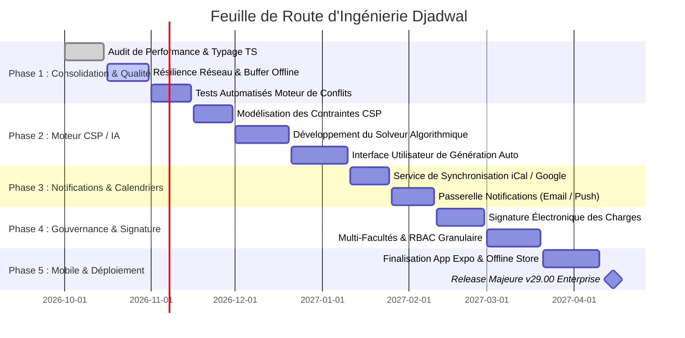
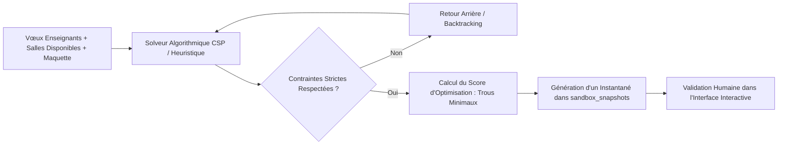

# Plan d'Implémentation & Feuille de Route Technique (IMPLEMENTATION PLAN) - Djadwal

**Nom du Projet :** Djadwal (نظام إدارة الجداول الأكاديمية)  
**Version de Base :** 28.11.25.Turso  
**Auteur / Lead Architecte :** Ali Hussain & Équipe Ingénierie Djadwal  
**Statut :** Plan Directeur d'Exécution & d'Évolution  
**Date :** 10 Octobre 2026  
**Dépôt :** `djalle2004-eng/Djadwal`  
**Documents Liés :** [PRD.md](file:///c:/perso/suivie%20online%20130425/suivie29092025/hyper-V/suivie/suivie/PRD.md) | [TRD.md](file:///c:/perso/suivie%20online%20130425/suivie29092025/hyper-V/suivie/suivie/TRD.md) | [APPFLOW.md](file:///c:/perso/suivie%20online%20130425/suivie29092025/hyper-V/suivie/suivie/APPFLOW.md) | [UX_UI_DESIGN.md](file:///c:/perso/suivie%20online%20130425/suivie29092025/hyper-V/suivie/suivie/UX_UI_DESIGN.md) | [BACKEND_SCHEMA.md](file:///c:/perso/suivie%20online%20130425/suivie29092025/hyper-V/suivie/suivie/BACKEND_SCHEMA.md)

---

## 1. Vue d'Ensemble & Stratégie d'Exécution

Le présent **Plan d'Implémentation** définit la trajectoire d'ingénierie logicielle pour consolider l'existant en production (version `28.11.25.Turso`) et déployer les évolutions majeures de la plateforme **Djadwal**.

### 1.1 Objectifs Clés du Plan
- **Fiabilisation de l'Architecture Hybride** : Renforcer la résilience de la synchronisation entre le cluster Turso Cloud et le cache local Better-SQLite3.
- **Automatisation Intelligente** : Intégrer un solveur algorithmique sous contraintes (CSP / IA) pour la génération assistée des emplois du temps.
- **Écosystème Connecté** : Synchroniser en temps réel les horaires avec les calendriers personnels (Google Calendar / iCal) et notifier instantanément enseignants et étudiants.
- **Rigueur Qualité & DevOps** : Mise en place d'une chaîne CI/CD complète avec tests unitaires, tests E2E du moteur de conflits et génération automatisée des installateurs Electron.

---

## 2. Chronogramme des Phases & Jalons (Roadmap Gantt)

---

## 3. Décomposition Détaillée des Phases Techniques

### Phase 1 : Consolidation, Résilience Réseau & Qualité (Semaines 1 à 6)
**Objectif :** Éliminer la dette technique, consolider les auto-migrations et garantir un fonctionnement fluide en cas de déconnexion réseau intermittente.

| Tâche | Description Technique | Fichiers Cibles | Livrable |
| :--- | :--- | :--- | :--- |
| **T1.1** | **Buffer de Synchronisation Hors-Ligne** : Implémentation d'une file d'attente locale (IndexedDB / SQLite local) stockant les mutations en cas de coupure de liaison vers Turso. | `server/database.js` `electron/database.js` `src/api/webClient.ts` | Mécanisme de replay automatique lors du retour en ligne. |
| **T1.2** | **Refactorisation & Typage Strict TypeScript** : Élimination des annotations `any` dans les payloads de sessions et harmonisation des interfaces `Assignment`. | `src/types/database.d.ts` `src/types/academicYear.ts` | Zéro avertissement TypeScript en build strict. |
| **T1.3** | **Banc de Tests Unitaires du Moteur de Conflits** : Couverture Jest/Vitest sur l'ensemble des cas limites (règle CM bloquant TD, enseignant indisponible, examens). | `src/services/assignmentService.test.ts` `server/conflictEngine.test.js` | 100 % de couverture sur les règles de rejet de créneaux. |
| **T1.4** | **Optimisation du Pipeline Electron Builder** : Compression des binaires Windows NSIS et réduction du poids de l'installateur sous la barre des 90 Mo. | `package.json` `electron/main.js` | Installateur optimisé avec signature de code. |

---

### Phase 2 : Moteur de Génération Algorithmique & Optimisation sous Contraintes (Semaines 7 à 14)
**Objectif :** Permettre la génération automatique d'un emploi du temps optimisé à partir des vœux du portail Takleef et des disponibilités de salles.

| Tâche | Description Technique | Fichiers Cibles | Livrable |
| :--- | :--- | :--- | :--- |
| **T2.1** | **Moteur de Programmation par Contraintes (CSP)** : Formalisation des variables (matière, groupe), des domaines (créneaux, salles) et des contraintes (non-chevauchement). | `server/engine/cspSolver.js` `server/engine/constraints.js` | Module de résolution autonome capable de traiter 200 séances en < 15s. |
| **T2.2** | **Fonction de Score & Optimisation Douce** : Minimisation des plages creuses (trous) dans les emplois du temps des étudiants et respect prioritaire des vœux des professeurs permanents. | `server/engine/objectiveFunction.js` | Métrique de qualité du planning (0 à 100%). |
| **T2.3** | **Interface UI de Génération Assistée** : Écran avec curseurs de pondération (priorité confort enseignant vs compacité des salles) et injection directe dans le mode Sandbox. | `src/pages/ScheduleAutoGenerator.tsx` `src/context/SandboxContext.tsx` | Assistant pas-à-pas de génération automatique. |

---

### Phase 3 : Synchronisation Multi-Canaux & Notifications Automatiques (Semaines 15 à 19)
**Objectif :** Notifier automatiquement les acteurs lors de toute modification d'horaire ou de salle et synchroniser leurs agendas externes.

| Tâche | Description Technique | Fichiers Cibles | Livrable |
| :--- | :--- | :--- | :--- |
| **T3.1** | **Flux iCalendar Dynamique (.ics)** : Génération d'une URL sécurisée par jeton unique permettant aux enseignants et étudiants de s'abonner via Google Calendar, Apple Calendar ou Outlook. | `server/routes/calendar.js` `server/services/icalService.js` | Endpoint `/api/calendar/subscribe/:token.ics` temps réel. |
| **T3.2** | **Centre de Notifications Événementielles** : Déclenchement automatique d'alertes par email lors du déplacement d'une séance (`SessionMove`) ou d'une permutation (`SessionSwap`). | `server/emailService.js` `server/routes.js` | Modèles d'emails bilingues (arabe/français) automatiques. |
| **T3.3** | **Webhooks & Intégration Telegram / WhatsApp** : Passerelle vers des canaux institutionnels de diffusion pour les annonces d'examens ou de rattrapage. | `server/services/webhookService.js` | Envoi d'annonces de groupe automatisé. |

---

### Phase 4 : Signature Électronique, Gouvernance & Multi-Entités (Semaines 20 à 25)
**Objectif :** Digitaliser la chaîne d'approbation administrative des états d'heures et des plannings officiels.

| Tâche | Description Technique | Fichiers Cibles | Livrable |
| :--- | :--- | :--- | :--- |
| **T4.1** | **Circuit de Validation Hiérarchique** : Workflow d'approbation d'un planning : Brouillon ➔ Soumis (Chef Département) ➔ Validé (Vice-Doyen) ➔ Scellé (Doyen). | `server/routes/approval.js` `src/pages/ApprovalWorkflow.tsx` | Horodatage cryptographique et gel des modifications. |
| **T4.2** | **Signature Numérique & Tampon PDF** : Apposition d'un certificat cryptographique et d'un QR code de vérification sur chaque page des plannings imprimés. | `src/pages/PrintSettingsNew.tsx` `server/services/pdfSigner.js` | Documents infalsifiables vérifiables par scan smartphone. |
| **T4.3** | **Cloisonnement Multi-Facultés (Multi-Tenancy)** : Isolation logique des données pour administrer plusieurs facultés ou instituts sur la même instance Turso. | `server/database.js` `src/context/FacultyContext.tsx` | Filtrage transparent par identifiant d'établissement. |

---

### Phase 5 : Finalisation Mobile & Déploiement Enterprise (Semaines 26 à 29)
**Objectif :** Déployer l'application mobile compagnon sur Android/iOS et finaliser le packaging Enterprise.

| Tâche | Description Technique | Fichiers Cibles | Livrable |
| :--- | :--- | :--- | :--- |
| **T5.1** | **Application Mobile Expo SDK 51** : Synchronisation hors-ligne avec SQLite local (Expo SQLite), notifications push de cours, et vue widget mobile. | `mobile/App.tsx` `mobile/src/screens/Timetable.tsx` | Fichiers APK / AAB prêts pour le Play Store institutionnel. |
| **T5.2** | **Pipeline CI/CD Automatisé** : GitHub Actions assurant le linting, les tests, le build web et la publication des releases GitHub avec binaires Electron Windows. | `.github/workflows/build-electron.yml` `.github/workflows/deploy-web.yml` | Pipeline de livraison continue zéro-intervention manuelle. |

---

## 4. Matrice de Gestion des Risques & Mesures d'Atténuation

| Risque Identifié | Impact | Probabilité | Stratégie d'Atténuation Technique |
| :--- | :--- | :--- | :--- |
| **Latence réseau Turso lors de la saisie intensive** | Élevé | Faible | Utilisation d'un cache local mémoire (`React Query / SWR`) avec écritures asynchrones optimistes (*Optimistic UI Updates*). |
| **Complexité combinatoire du solveur CSP (blocage)** | Moyen | Moyen | Limitation du temps de calcul avec timeout strict (15s), algorithme génétique de secours, et retour à la meilleure solution partielle trouvée. |
| **Dégradation du rendu typographique arabe dans les PDF** | Élevé | Faible | Verrouillage des versions des bibliothèques `@pdf-lib/fontkit` et `jspdf-autotable`, avec tests de régression visuelle automatisés par comparaison d'images. |
| **Perte accidentelle de brouillons en mode Sandbox** | Élevé | Très Faible | Double protection : hook `useBlocker`, écouteur `beforeunload`, et sauvegarde automatique temporaire dans le `localStorage` toutes les 60 secondes. |

---

## 5. Critères de Réception & Validation (Definition of Done)

Chaque fonctionnalité de ce plan est considérée comme terminée uniquement lorsque les critères suivants sont satisfaits :
1. **Conformité au Cahier des Charges :** Répond strictement aux exigences décrites dans [PRD.md](file:///c:/perso/suivie%20online%20130425/suivie29092025/hyper-V/suivie/suivie/PRD.md) et [TRD.md](file:///c:/perso/suivie%20online%20130425/suivie29092025/hyper-V/suivie/suivie/TRD.md).
2. **Respect des Flux & Design :** Implémentation conforme aux flux décrits dans [APPFLOW.md](file:///c:/perso/suivie%20online%20130425/suivie29092025/hyper-V/suivie/suivie/APPFLOW.md) et à la charte [UX_UI_DESIGN.md](file:///c:/perso/suivie%20online%20130425/suivie29092025/hyper-V/suivie/suivie/UX_UI_DESIGN.md).
3. **Intégrité des Données :** Validé contre le schéma [BACKEND_SCHEMA.md](file:///c:/perso/suivie%20online%20130425/suivie29092025/hyper-V/suivie/suivie/BACKEND_SCHEMA.md) avec migration idempotente.
4. **Validation Bilingue & RTL :** Testé en langue Arabe (RTL) et Français sans défaut d'alignement.
5. **Couverture de Tests :** Passage avec succès des tests unitaires et d'intégration sans régression sur le moteur de détection de conflits.
